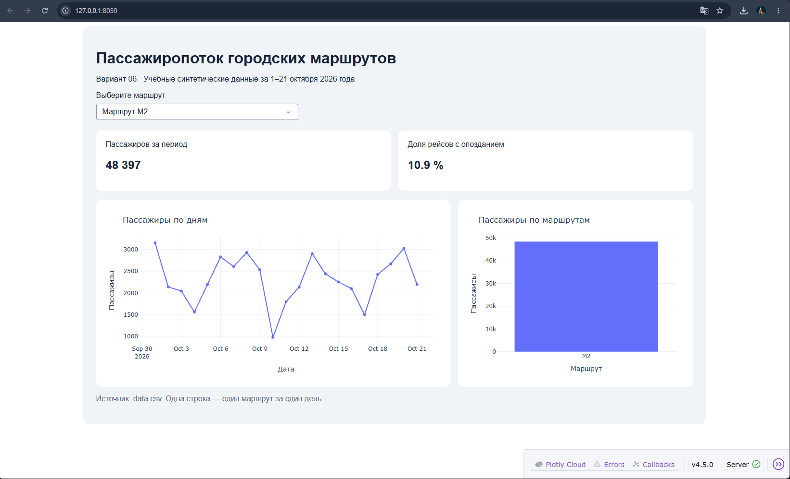

# Анализ пассажиропотока городских маршрутов

Интерактивный дашборд на Dash: пассажиропоток по дням, суммарный поток по маршрутам и доля опоздавших рейсов с фильтром по маршруту (M1, M2, M3 или все).

## Запуск

```
python -m venv .venv
.venv\Scripts\activate        # Windows (cmd); в PowerShell: .\.venv\Scripts\Activate.ps1
python -m pip install -r requirements.txt
python app.py
```

Откройте http://127.0.0.1:8050 в браузере.

## Результаты анализа

Имя и фамилия: Кирилл Гласинскас.

Вариант: 06.

Исходный файл: `datasets/variant_06.csv` скопирован как `data.csv`.

1. Самый загруженный маршрут за весь период: **M2** — 48 397 пассажиров (M1 — 41 797, M3 — 36 108; всего 126 302).
2. Максимальный суммарный пассажиропоток за день: **20 октября 2026 года** — 7 895 пассажиров.


